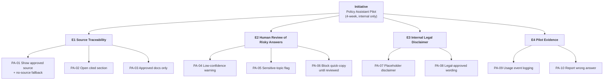
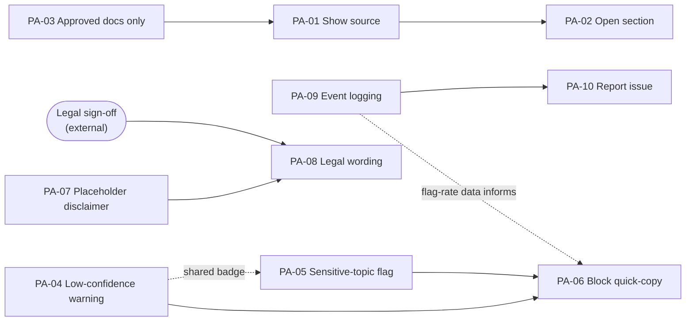

# Epic Map: Policy Assistant Pilot

> **Status:** Draft for PM approval. Story details are in `story-backlog.md`,
> and acceptance criteria are in `acceptance-criteria.md`.

## Initiative

**Policy Assistant Pilot:** Within four weeks, give internal support agents an
AI assistant that answers only from approved policy documents. Every answer
must be traceable, risky answers must go to human review, and the pilot must
produce evidence about time saved and answer risk.

## Map

## Epics, Outcomes, and Scenario Constraints

| Epic | Outcome | Scenario constraint it addresses | Stories |
|---|---|---|---|
| **E1 Source Traceability** | Agents can see and open the approved source behind every answer. If there's no approved source, no answer is shown. | "Approved policy documents only"; "source traceability before customer answers" | PA-01, PA-02, PA-03 |
| **E2 Human Review of Risky Answers** | Low-confidence and sensitive answers are visibly flagged. Blocking is added only if pilot data supports it. | "Human review for flagged answers" | PA-04, PA-05, PA-06 |
| **E3 Internal Legal Disclaimer** | Agents see a disclaimer from day one, and it's replaced with Legal's wording when available. | "Legal review for disclaimer wording" | PA-07, PA-08 |
| **E4 Pilot Evidence** | The PM can report on time saved and answer risk using agreed measures. | "Evidence that the pilot saves time without increasing answer risk" | PA-09, PA-10 |

## Dependencies

External or unresolved dependencies (see the Assumption Register in
`story-backlog.md`):

- **Section metadata and indexing:** A-1, A-4
- **Approval status in a system of record:** A-2
- **Confidence score from the pipeline:** A-5
- **Sensitive-topic list owner:** A-6
- **Legal sign-off on wording:** A-10
- **Privacy approval for logging:** A-12

## Scope Boundaries

| In scope | Out of scope (decided) |
|---|---|
| Internal support tool used by pilot support agents | Any customer-facing feature *(rejected by PM as scope expansion)* |
| Approved policy documents in the agreed pilot set | Disclaimer text in customer messages |
| Warning and review flags inside the agent workflow | Automated sending of answers to customers |
| Pilot evaluation logging | Production rollout beyond the 4-week pilot |
| Placeholder disclaimer while Legal reviews | Changes to the content of the policy documents themselves |

## Ownership Decisions

- **The "no approved source found" fallback belongs to PA-01 (E1)**, not E2.
  This avoids duplicate behavior between traceability and human review.
